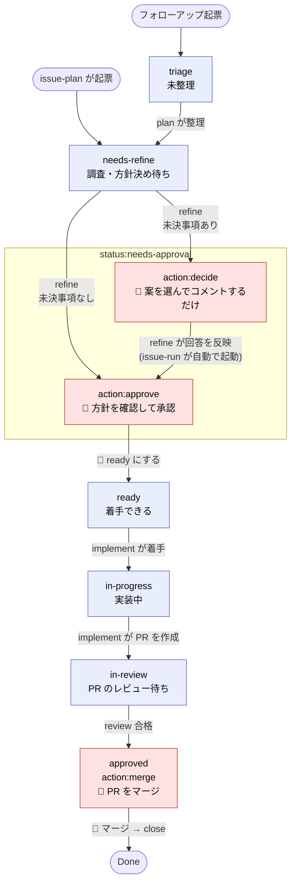
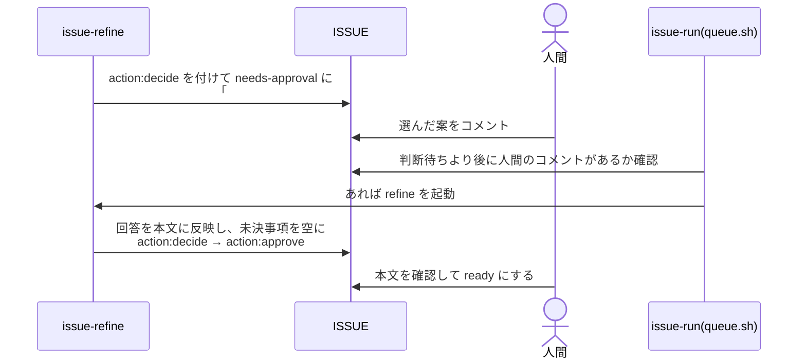

# issue-flow の状態遷移

人間向けの図解。決まりの正は [conventions.md](conventions.md)(§3)で、食い違ったらそちらに従う。

- 四角の中の上段が `status:*`(状態)。状態の変更は必ず `set-status.sh` を通す
- 赤い箱は**人間の番**。付いている `action:*` が「人間が今やること」を表す
- `issue-run` は青い箱の工程(refine / implement / review)だけを自動で回す

## 前に進む流れ

`needs-approval` の中で `decide` から `approve` に移っても、状態ラベルは変わらない
(`action:*` だけが替わる)。`ready` にするのは常に人間。

小さく明確な ISSUE は、issue-plan が `needs-refine` を飛ばして直接 `action:approve` にすることがある。

## 戻る流れ(差し戻し)

| 元 | 先 | 誰が | いつ |
|---|---|---|---|
| `needs-approval`(approve) | `needs-refine` | 👤 人間 | 方針に直す点がある。コメントで指摘してから戻す |
| `in-progress` | `needs-refine` | implement | 本文の方針では進められない・判断が要る点が見つかった |
| `in-review` | `in-progress` | review | 実装の不備で不合格(1つの PR につき 2 回まで) |
| `in-review` | `needs-refine` | review | 3 回目の不合格、または方針そのものに問題がある |

`needs-refine` に戻ったものは、refine がコメントを読んで方針を直し、再び `needs-approval` に来る。

## 判断待ち(action:decide)の回し方

人間は**コメントを書くだけ**で、状態もラベルも触らない。

skill が書くコメントは先頭行が `## issue-` で始まる。それ以外のコメントが人間の回答とみなされる。

## 要確認(action:check)

状態に関係なく付く。issue-run が付けるのは次のとき:

- `stale`: `in-progress` なのに、修正待ちの判定も起動中の印も無い
- 前のセッションの `flow:running` が残っている
- 起動したエージェントの後で状態が進まなかった

付いている間、issue-run はその ISSUE を一切起動しない。中身を見て対処したら人間が外す。
外したあと `action:approve` / `action:merge` は次の `set-status.sh`(か `setup.sh resync`)で付き直るが、
`action:decide` は付き直らないので、判断待ちに戻すなら手で付ける。
